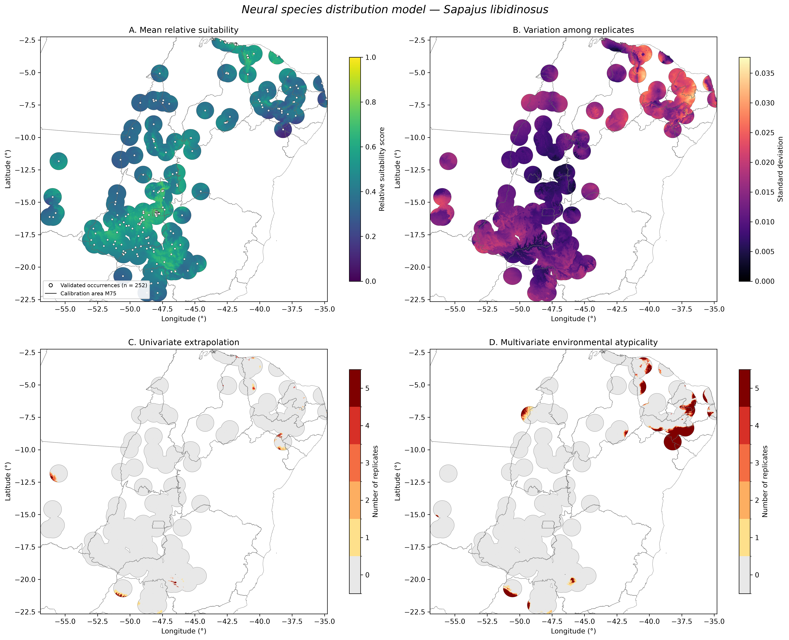

# Neural SDM — Sapajus libidinosus

**Neural Species Distribution Modeling with Nested Spatial Cross-Validation**

A Python-based workflow for species distribution modeling using
artificial neural networks, spatial cross-validation, pseudoabsence
replicates, and environmental novelty diagnostics.

## Spatial predictions

The figure presents mean relative suitability, variation among
pseudoabsence replicates, univariate extrapolation, and multivariate
environmental atypicality.

## Methodological workflow

1. Occurrence quality control and geographic validation.
2. Environmental predictor selection and extraction.
3. Calibration area delineation (M75).
4. Generation of five pseudoabsence replicates.
5. Five-fold nested spatial cross-validation.
6. Neural network architecture selection and training.
7. Spatial prediction and environmental novelty diagnostics.

## Model configuration

| Component | Description |
|---|---|
| Species | Sapajus libidinosus |
| Validated occurrences | 252 |
| Calibration area | M75 |
| Environmental predictors | BIO1, BIO4, BIO12, BIO15 |
| Pseudoabsence replicates | 5 |
| Pseudoabsences per replicate | 1,260 |
| Neural network framework | TensorFlow / Keras |

## Model performance

Mean spatial ROC-AUC: approximately 0.589.

The model showed modest discrimination across geographically
structured test folds. Predictions are exploratory relative
suitability scores, not calibrated probabilities of occurrence.

## Environmental diagnostics

- Univariate extrapolation: 1.13% of projected cells.
- Multivariate environmental atypicality: 6.68% of projected cells.

## Reproducibility

The notebooks document the analytical workflow. Raw datasets,
intermediate outputs, and trained models are not included.
Complete end-to-end reproduction has not yet been verified.

## Author

André Felipe Carneiro dos Santos

Quantitative Ecology | Ecological Modeling | Conservation Informatics

## Project status

Research prototype — methodological development and validation.
